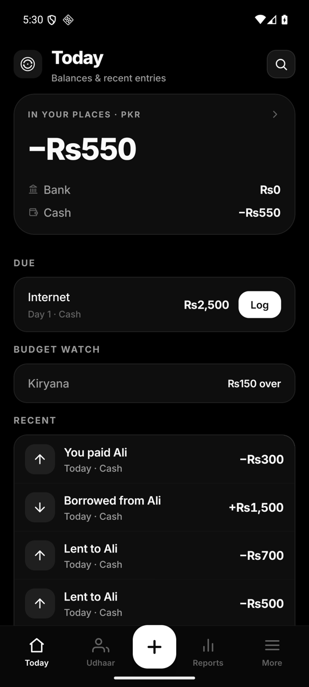
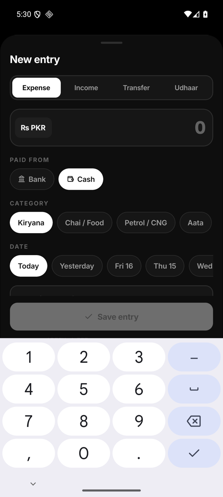
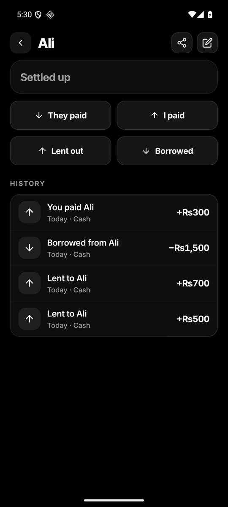
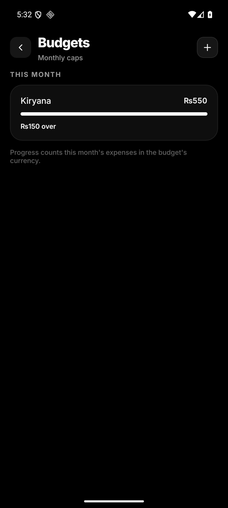

# Udhaar

A personal money & **udhaar** ledger for your phone — track income and expenses, and
keep a running record of what you've lent to or borrowed from people.

Phone-first, device-local, Pakistani defaults (PKR, JazzCash / Easypaisa / Raast),
with a 3-second capture flow. **No accounts, no server, no analytics.**

  
  
  
  

## Install

1. On your phone, open the [latest release](https://github.com/InvariantPause/udhaar/releases/latest)
   and download the APK.
2. Android asks you to allow installs from this source — allow it for your browser once.
3. Install. Updates install in place: your data is kept.

Each release lists a SHA-256 checksum if you want to verify the download.

## What you can do

- **Quick capture** — a bottom sheet with a numeric keypad and one-tap categories.
  Add an entry in about three seconds.
- **Today** — balances and recent entries at a glance, plus anything due and a
  quiet budget watch.
- **Udhaar ledger** — a per-person running balance (lent, borrowed, paid back),
  with a statement you can share.
- **Search** — find any entry by note, person, place, amount, kind or period.
- **Budgets** — a monthly cap per category, tracked on Today and Reports.
- **Recurring bills** — rent, internet, fees: log them in one tap on their day.
- **Reports** — this month / last month / all time, per currency — never converted.
- **Multi-currency** — PKR (default), USD, INR, EUR.
- **Backup** — export / import JSON, replace or merge.
- **App lock** — optional lock behind your phone's own screen lock.
- **Everything is deletable** — soft-delete with undo.

## Your data

- Everything lives in a local database on your phone. No accounts, no sync, no
  analytics — the app makes no network calls, and Android cloud backup is disabled.
- Backups are plain JSON files you export and keep yourself (**More → Your data**).
  Treat them like cash: they contain your whole ledger.

## Good to know

- The interface is English with light Pakistani context (Kiryana, Aata, Zakat, Eidi…).
- Currencies never get converted — totals are always per currency.
- Android-only for now. Installing a newer APK over an older one keeps your data.

## License

© 2026 InvariantPause. All rights reserved. The source is published for
transparency; no permission is granted to copy, modify, or redistribute it.
See [LICENSE](LICENSE).

---

Building Udhaar yourself? See [docs/DEVELOPING.md](docs/DEVELOPING.md).
